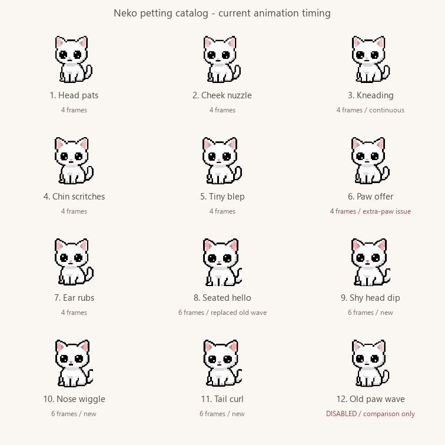

# Desktop Neko 🐾

A little company for your Windows desktop. Neko stretches, settles down, notices
your cursor, and naps when you step away. No chores, guilt, or attention meter.
Soft sounds are optional and off until you enable them.



## Living with Neko

- **Click to pet.** Twelve four-frame reactions: head pats, cheek nuzzles,
  kneading, chin scritches, a tiny blep, offering a paw, relaxed ear rubs,
  a front stretch, back arch, tiny hop, side flop, and shoulder peek.
  Paw offer uses a new drawing sequence; the old malformed wave and paw drawings
  are excluded from playback. Each plays gently and settles; all twelve appear
  before the rotation repeats. Six-frame reactions have been removed.
  If she's asleep, a pet plays her waking sequence instead.
- **Drag to move.** She looks around while held and blinks when set down. Dragging
  never counts as petting. Position is remembered, including on another monitor.
- **Come close.** She sniffs at a moving cursor and sometimes takes a small walk
  left or right toward it, keeping the same height. Each walk can last 6.5 seconds, travels at most about 220 pixels,
  and keeps a gap from the arrow. Mouse following is optional, with a 25-second rest.
- **Keep working.** Tail swishes, ear flicks, sniffing, loafing, grooming, stretches,
  yawns and sleepy peeks use 144 loaded drawings, including eight-frame transitions into
  sleep and back to sitting. Most gestures have 5–6 seconds on screen: one gentle
  motion followed by a relaxed rest, without repeated head-bobbing or stretching.
  Tail swishes, kneading and paw taps use slower continuous cycles. Rendering runs at
  10 FPS, keeping the same action lengths and walking speed.
  Every frame has a 112 × 100 transparent canvas;
  retained seated poses share an 82-pixel height. New body movements keep one
  scale across each sequence so crouching and lying down do not enlarge her head.
  Walking, loafing and sleep preserve their natural posture and proportions.
- **A little tail trouble.** Two eight-drawing idle games: she turns in a compact
  circle chasing her tail, or stays seated and tries to trap its tip between her
  forepaws. Each plays once, then rests. These do not change the twelve pet reactions.
- **Hello and goodbye.** Starting the app plays a drop-in, landing crouch and
  sit-up before her greeting. **Let her go · quit** gives her a wistful pause and
  a hop down out of view before closing. These eight-drawing transitions last
  about two seconds, keep her saved desktop position, and do not accept pets or
  window reactions midway through. Reduced motion skips the jumps; quitting
  while hidden or fullscreen is immediate. Hide/Show remains immediate.
- **Type together.** A typing burst gets a few little paw taps and a local thought
  such as “whatcha typing?”, at most once every 30 seconds.
- **Open, close, or move windows.** Native events earn a look, blink and contextual
  line, with an eight-second visual cooldown. Foreground app selections and title
  changes also hint at internal tab/document changes. Events wait briefly for an
  ongoing animation instead of disappearing immediately.
- **Step away.** She yawns and naps after a configurable period without input.
  The default is three minutes; choose 1–3600 seconds. Type a number and press Enter
  or leave the field to save it. **Nap duration** independently chooses how long
  she stays asleep: 1–3600 seconds, or 0 (**Until petted**, the default).
  The nap clock starts when she finishes curling down; changes apply to the current nap.
  Typing, app switches and dragging let her sleep. A pet wakes her early,
  and timed naps use the same gentle waking transition. After waking she stays
  awake for at least the inactivity delay before another nap.
  Ignoring her never creates chores or penalties.
- **Offline personality.** 298 short lines, including more personal questions and
  company addressed to you, shuffled separately for typing,
  windows, pets, cursor curiosity, waking, and idle thoughts. No repeat until that
  context's bag is exhausted. Ambient thoughts default to about 75 seconds apart.
  All automatic words share an 8–30 second pause and never replace a visible bubble.
- **Little app rituals.** VLC gets a watch-buddy loaf and questions about what
  you're watching; audio file titles and Spotify get listening questions and tail
  swishes. Coding, drawing, writing, chat, games, folders and terminals each have
  their own lines and matching gestures. These are app hints, not content analysis.
- **Soft mews & purrs.** Enable them in the nook's Settings tab; Listen previews a
  small mew. These original synthesized cues are up to a second long, with low
  volume encoded into the WAV files. A deliberate pet can purr or mew; she can
  chirp on arrival. Automatic cues have a 45-second pause and are suppressed during media apps,
  quiet company and fullscreen. Turning sounds off or hiding stops playback.
- **Right-click for her nook.** Quiet company, reduced motion, startup, optional
  AI, mouse following, sleep delay and duration, chatter and idle gesture frequency, and lifetime
  pet/nap counts live in one small window. Double-click the tray
  icon to find her again.
  Menus and the nook open beside her, with no periodic re-pinning over the controls.

Quiet company stops unprompted words and sounds while keeping deliberate pet reactions.
Hide really hides her: no surprise appearances, bubbles, or animation. Native
topmost positioning keeps her above normal windows without stealing focus.
**Tuck away during fullscreen apps** is a separate, opt-in choice in the nook.
Fullscreen activity always suppresses automatic words and typing/window reactions,
even when she remains visible. Exclusive-fullscreen games and other topmost overlays
can still cover desktop windows. Only one copy runs at a time.

Typing and window reactions work locally and can be switched off. Keyboard
detection requests only raw-input headers: key identities, text and passwords are
never read, reconstructed, saved, or sent anywhere. Window reactions use native
events plus a local, temporary hash of the foreground window title to notice
changes, plus the foreground executable's name for app-specific reactions. Titles
are used briefly for local media hints, then discarded; neither titles nor app
history are stored or transmitted in offline mode. Optional AI has
its own title-sharing toggle below. Apps expose different accessibility events:
internal tabs are hints, not universal exact tracking. Background tabs are not
tracked. See [Microsoft's event reference](https://learn.microsoft.com/en-us/windows/win32/winauto/event-constants).

## Run from source

Windows 10/11, Python 3.11 or newer. Tested with Python 3.13 and Qt 6.12.

```powershell
python -m venv .venv
.venv\Scripts\python.exe -m pip install -r requirements.txt
.venv\Scripts\pythonw.exe main.py
```

Preferences and lifetime counts use per-user Windows settings
(`HKEY_CURRENT_USER\Software\DesktopNeko\Neko`). Startup is opt-in from the nook;
existing startup registrations from the old version remain in place until changed.
Turning startup off also removes the old `DesktopNeko.lnk` shortcut. Keep the
executable/source folder in a stable location if using startup.

## Optional AI observations

The pet works offline. AI is off by default. To enable it:

1. Set `GEMINI_API_KEY` in the environment **before launching Neko**, or copy
   `config.example.json` to `config.json` and fill in your own key.
2. Open the nook and enable **AI observations**.

For a packaged executable, `config.json` belongs beside the executable. Keys are
never included in a build. If a key was committed in an older revision, rotate it:
ignoring the file now does not remove it from Git history.

When an unprompted comment is due, AI sends the **current window title** to Google
Gemini, at most once every ten minutes. Other comments remain offline. Window
titles may contain private names or document titles. No screenshots,
microphone, files, or conversation history are collected. Quiet mode and hiding
prevent new requests. An already-sent request cannot be retracted, but its reply
is discarded after hiding, petting, entering fullscreen, or changing AI/quiet mode.

The default model is `gemini-3.5-flash-lite`; set `GEMINI_MODEL` to override it.
Requests use a 12-second HTTP timeout without retries. Missing keys, network
failures, or empty responses fall back to local dialogue without error bubbles.
The nook shows connection status. No real API calls are made by the tests.

SDK configuration follows the [Google Gen AI SDK](https://github.com/googleapis/python-genai).
Model availability is listed in [Google's model lifecycle documentation](https://ai.google.dev/gemini-api/docs/deprecations).

## Build a Windows executable

```powershell
.venv\Scripts\python.exe -m pip install -r requirements-build.txt
.venv\Scripts\python.exe -m PyInstaller --noconfirm --clean main.spec
```

The result is `dist\DesktopNeko.exe`. Assets are bundled; local configuration is
deliberately excluded. Build on Windows. A source launch and the executable use
the same preferences and instance lock. The build isolates its DLL search path
so unrelated tools cannot supply conflicting Windows libraries.

## Check the behavior

```powershell
.venv\Scripts\python.exe -m unittest discover -v
```

Tests cover animation timing, frame importing, header-only keyboard detection,
window events, quiet timing, naps, curiosity, clicks versus dragging, fullscreen
preferences, pinning flags, persistence, stale AI replies and API failure handling.
Qt tests default to offscreen rendering with temporary settings.
For native Windows widgets, set `$env:QT_QPA_PLATFORM = 'windows'` before running.
Tests do not change Windows startup or use your API key.

After building, quit any running Neko and check the actual executable as well:

```powershell
$env:NEKO_TEST_EXE = 'dist\DesktopNeko.exe'
.venv\Scripts\python.exe -m unittest test_packaging -v
Remove-Item Env:NEKO_TEST_EXE
```

These opt-in checks verify bundle contents, native Qt startup, and rejection of
a second instance. They respect foreground fullscreen apps and stop only the
processes they launch.

## Character assets

The four `assets/neko-*-v3.png` sheets each contain four sequences of four drawings.
`assets/neko-transitions-v1.png` adds sixteen sleep/wake drawings with a constant
character scale through the change in posture. `assets/neko-affection-v1.png`
supplies the retained chin scritches, blep and ear rubs.
`assets/neko-petting-a-v1.png` and `assets/neko-petting-b-v1.png` each contain
three rows of four drawings, for five new reactions and the remade paw offer.
The old wave and old paw-offer rows are never loaded into the atlas. Frame
durations and directional variants live in `animations.py`. Frames are imported
once at a consistent scale and anchored at their feet. Generated-sheet bleed from
neighboring cells is excluded when locating each silhouette.

The [generation prompts and art notes](docs/animation-notes.md) document the built-in
ImageGen workflow; [tail and lifecycle notes](docs/tail-lifecycle-notes.md) include
the new motion references, prompts and eight-frame previews. The original six
transparent PNGs remain as fallbacks. Matching
GIFs in `assets/` still take precedence over the atlas for customization. Motion can
be disabled in the nook, holding a still frame without losing direct interaction.
Missing art has a small text-cat fallback.
`gen_gif.py` is the original optional animation experiment; it needs Pillow and
generates a bouncing ball, so it isn't part of the app or build.

## Project map

- `behavior.py`: timing, temporary poses, naps, and pet reactions; no Qt or network.
- `main.py`: desktop integration, rendering, preferences, nook, and tray.
- `animations.py`: sprite atlas loading, frame timing and directional clips.
- `activity.py`: local keyboard headers, Windows events and foreground executable name.
- `app_context.py`: local app categories and media title hints.
- `dialogue.py`: offline lines and per-context shuffle bags.
- `tools/make_sounds.py`: reproducible, original synthesized WAV cues; standard library only.
- `llm_brain.py`: optional title-only Gemini worker.
- `test_*.py`: standard-library unittest suite, with Qt's event helpers.
- `Plan.txt`: interaction rules for keeping future changes quiet and minimal.

Built by Sobi, who kinda likes Nekos.
