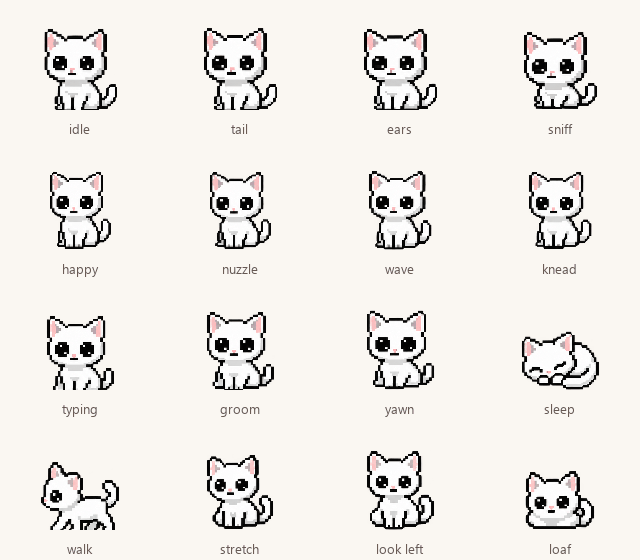

# Desktop Neko 🐾

A little company for your Windows desktop. Neko stretches, settles down, notices
your cursor, and naps when you step away. No chores, guilt, sounds, or attention meter.



## Living with Neko

- **Click to pet.** Closed-eye kneading, a tiny heart, and an occasional written purr.
- **Drag to move.** She looks around while held and blinks when set down. Dragging
  never counts as petting. Position is remembered, including on another monitor.
- **Come close.** She occasionally looks toward your cursor. She never chases it.
- **Keep working.** Blinks, paw washing, stretches, yawns, and sleepy peeks use
  64 drawn frames with individual timing, rather than rotating or stretching a still.
- **Type together.** A typing burst occasionally gets a few little paw taps,
  at most once every 45 seconds. She then goes back to her own business.
- **Open, close, or move windows.** Native events earn a curious look or blink,
  at most once every 18 seconds. A current-window title change can also trigger a
  glance when the app exposes that event, including some browser tab changes.
- **Step away.** After three minutes without keyboard or mouse input, she naps.
  She yawns first; returning wakes her with a silent stretch. There is no penalty
  for ignoring her. Actions finish naturally instead of interrupting one another.
- **Very occasional words.** Unprompted bubbles are spaced 12–20 minutes apart.
  Petting postpones them; no back-to-back identical idle lines.
- **Right-click for her nook.** Quiet company, reduced motion, startup, optional
  AI, and lifetime pet/nap counts live in one small window. Double-click the tray
  icon to find her again.

Quiet company stops unprompted words while keeping deliberate pet reactions.
Hide really hides her: no surprise appearances, bubbles, or animation. Native
topmost positioning keeps her above normal windows without stealing focus.
**Tuck away during fullscreen apps** is a separate, opt-in choice in the nook.
Fullscreen activity always suppresses automatic words and typing/window reactions,
even when she remains visible. Exclusive-fullscreen games and other topmost overlays
can still cover desktop windows. Only one copy runs at a time.

Typing and window reactions work locally and can be switched off. Keyboard
detection requests only raw-input headers: key identities, text and passwords are
never read, reconstructed, saved, or sent anywhere. Window reactions use events and
handles, without reading titles. Optional AI has its own title-sharing toggle below.
Exact browser tab creation/closure, especially in background tabs, needs a browser
extension; this version deliberately ships without one.

## Run from source

Windows 10/11, Python 3.11 or newer. Tested with Python 3.13 and Qt 6.12.

```powershell
python -m venv .venv
.venv\Scripts\python.exe -m pip install -r requirements.txt
.venv\Scripts\pythonw.exe main.py
```

Preferences and lifetime counts use per-user Windows settings
(`HKEY_CURRENT_USER\Software\DesktopNeko\Neko`). Startup is opt-in from the nook;
existing startup registrations from the old version remain in place until changed.
Turning startup off also removes the old `DesktopNeko.lnk` shortcut. Keep the
executable/source folder in a stable location if using startup.

## Optional AI observations

The pet works offline. AI is off by default. To enable it:

1. Set `GEMINI_API_KEY` in the environment **before launching Neko**, or copy
   `config.example.json` to `config.json` and fill in your own key.
2. Open the nook and enable **AI observations**.

For a packaged executable, `config.json` belongs beside the executable. Keys are
never included in a build. If a key was committed in an older revision, rotate it:
ignoring the file now does not remove it from Git history.

When an unprompted comment is due, AI sends the **current window title** to Google
Gemini. Window titles may contain private names or document titles. No screenshots,
microphone, files, or conversation history are collected. Quiet mode and hiding
prevent new requests. An already-sent request cannot be retracted, but its reply
is discarded after hiding, petting, entering fullscreen, or changing AI/quiet mode.

The default model is `gemini-3.5-flash-lite`; set `GEMINI_MODEL` to override it.
Requests use a 12-second HTTP timeout without retries. Missing keys, network
failures, or empty responses fall back to local dialogue without error bubbles.
The nook shows connection status. No real API calls are made by the tests.

SDK configuration follows the [Google Gen AI SDK](https://github.com/googleapis/python-genai).
Model availability is listed in [Google's model lifecycle documentation](https://ai.google.dev/gemini-api/docs/deprecations).

## Build a Windows executable

```powershell
.venv\Scripts\python.exe -m pip install -r requirements-build.txt
.venv\Scripts\python.exe -m PyInstaller --noconfirm --clean main.spec
```

The result is `dist\DesktopNeko.exe`. Assets are bundled; local configuration is
deliberately excluded. Build on Windows. A source launch and the executable use
the same preferences and instance lock. The build isolates its DLL search path
so unrelated tools cannot supply conflicting Windows libraries.

## Check the behavior

```powershell
.venv\Scripts\python.exe -m unittest discover -v
```

Tests cover animation timing, frame importing, header-only keyboard detection,
window events, quiet timing, naps, curiosity, clicks versus dragging, fullscreen
preferences, pinning flags, persistence, stale AI replies and API failure handling.
Qt tests default to offscreen rendering with temporary settings.
For native Windows widgets, set `$env:QT_QPA_PLATFORM = 'windows'` before running.
Tests do not change Windows startup or use your API key.

After building, quit any running Neko and check the actual executable as well:

```powershell
$env:NEKO_TEST_EXE = 'dist\DesktopNeko.exe'
.venv\Scripts\python.exe -m unittest test_packaging -v
Remove-Item Env:NEKO_TEST_EXE
```

These opt-in checks verify bundle contents, native Qt startup, and rejection of
a second instance. They respect foreground fullscreen apps and stop only the
processes they launch.

## Character assets

`assets/neko-atlas.png` contains eight sequences of eight drawings: blink/idle,
looking around, typing, grooming, stretching, yawning, affection and sleep. Frame
durations and directional variants live in `animations.py`. Frames are imported
once at a consistent scale and anchored at their feet. Generated-sheet bleed from
neighboring cells is excluded when locating each silhouette.

The [generation prompts and art notes](docs/animation-notes.md) document the built-in
ImageGen workflow. The original six transparent PNGs remain as fallbacks. Matching
GIFs in `assets/` still take precedence over the atlas for customization. Motion can
be disabled in the nook, holding a still frame without losing direct interaction.
Missing art has a small text-cat fallback.
`gen_gif.py` is the original optional animation experiment; it needs Pillow and
generates a bouncing ball, so it isn't part of the app or build.

## Project map

- `behavior.py`: timing, temporary poses, naps, and pet reactions; no Qt or network.
- `main.py`: desktop integration, rendering, preferences, nook, and tray.
- `animations.py`: sprite atlas loading, frame timing and directional clips.
- `activity.py`: local keyboard-activity headers and Windows lifecycle events.
- `llm_brain.py`: optional title-only Gemini worker.
- `test_*.py`: standard-library unittest suite, with Qt's event helpers.
- `Plan.txt`: interaction rules for keeping future changes quiet and minimal.

Built by Sobi, who kinda likes Nekos.
