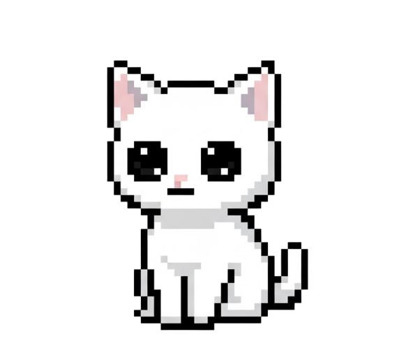

# Desktop Neko 🐾

A little company for your Windows desktop. Neko stretches, settles down, notices
your cursor, and naps when you step away. No chores, guilt, sounds, or attention meter.



## Living with Neko

- **Click to pet.** A happy pose, a tiny heart, and an occasional purr.
- **Drag to move.** Position is remembered, including on another monitor.
- **Come close.** She occasionally tilts toward your cursor. She never chases it.
- **Keep working.** Little stretches and sleepy peeks happen every 25–55 seconds.
  Window changes can earn a silent curious look, at most once every 45 seconds.
- **Step away.** After three minutes without keyboard or mouse input, she naps.
  Returning wakes her silently. There is no penalty for ignoring her.
- **Very occasional words.** Unprompted bubbles are spaced 12–20 minutes apart.
  Petting postpones them; no back-to-back identical idle lines.
- **Right-click for her nook.** Quiet company, reduced motion, startup, optional
  AI, and lifetime pet/nap counts live in one small window. Double-click the tray
  icon to find her again.

Quiet company stops unprompted words while keeping deliberate pet reactions.
Hide really hides her: no surprise appearances, bubbles, or animation. Fullscreen
apps automatically tuck her away until you return. Neither the pet nor her
bubbles take keyboard focus. Only one copy runs at a time.

## Run from source

Windows 10/11, Python 3.11 or newer. Tested with Python 3.13 and Qt 6.12.

```powershell
python -m venv .venv
.venv\Scripts\python.exe -m pip install -r requirements.txt
.venv\Scripts\pythonw.exe main.py
```

Preferences and lifetime counts use per-user Windows settings
(`HKEY_CURRENT_USER\Software\DesktopNeko\Neko`). Startup is opt-in from the nook;
existing startup registrations from the old version remain in place until changed.
Turning startup off also removes the old `DesktopNeko.lnk` shortcut. Keep the
executable/source folder in a stable location if using startup.

## Optional AI observations

The pet works offline. AI is off by default. To enable it:

1. Set `GEMINI_API_KEY` in the environment **before launching Neko**, or copy
   `config.example.json` to `config.json` and fill in your own key.
2. Open the nook and enable **AI observations**.

For a packaged executable, `config.json` belongs beside the executable. Keys are
never included in a build. If a key was committed in an older revision, rotate it:
ignoring the file now does not remove it from Git history.

When an unprompted comment is due, AI sends the **current window title** to Google
Gemini. Window titles may contain private names or document titles. No screenshots,
microphone, files, or conversation history are collected. Quiet mode and hiding
prevent new requests. An already-sent request cannot be retracted, but its reply
is discarded after hiding, petting, entering fullscreen, or changing AI/quiet mode.

The default model is `gemini-3.5-flash-lite`; set `GEMINI_MODEL` to override it.
Requests use a 12-second HTTP timeout without retries. Missing keys, network
failures, or empty responses fall back to local dialogue without error bubbles.
The nook shows connection status. No real API calls are made by the tests.

SDK configuration follows the [Google Gen AI SDK](https://github.com/googleapis/python-genai).
Model availability is listed in [Google's model lifecycle documentation](https://ai.google.dev/gemini-api/docs/deprecations).

## Build a Windows executable

```powershell
.venv\Scripts\python.exe -m pip install -r requirements-build.txt
.venv\Scripts\python.exe -m PyInstaller --noconfirm --clean main.spec
```

The result is `dist\DesktopNeko.exe`. Assets are bundled; local configuration is
deliberately excluded. Build on Windows. A source launch and the executable use
the same preferences and instance lock.

## Check the behavior

```powershell
.venv\Scripts\python.exe -m unittest discover -v
```

Tests cover quiet timing, naps, curiosity, clicks versus dragging, fullscreen and
hide behavior, persistence, stale AI replies, single-flight requests, and API
failure handling. Qt tests default to offscreen rendering with temporary settings.
For native Windows widgets, set `$env:QT_QPA_PLATFORM = 'windows'` before running.
Tests do not change Windows startup or use your API key.

## Character assets

The original six transparent PNGs are retained. You can replace them in `assets/`
or provide matching GIFs, which take precedence. Motion can be disabled in the
nook; GIFs then display a still frame. Missing art has a small text-cat fallback.
`gen_gif.py` is the original optional animation experiment; it needs Pillow and
generates a bouncing ball, so it isn't part of the app or build.

## Project map

- `behavior.py`: timing, temporary poses, naps, and pet reactions; no Qt or network.
- `main.py`: desktop integration, rendering, preferences, nook, and tray.
- `llm_brain.py`: optional title-only Gemini worker.
- `test_*.py`: standard-library unittest suite, with Qt's event helpers.
- `Plan.txt`: interaction rules for keeping future changes quiet and minimal.

Built by Sobi, who kinda likes Nekos.
