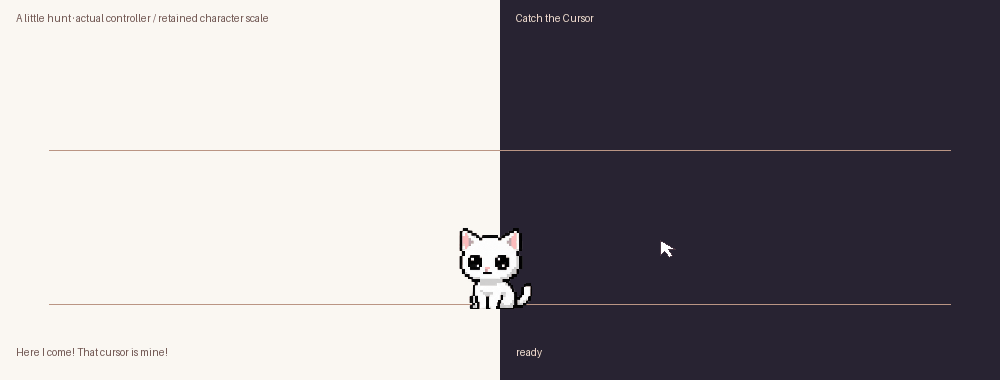

# Catch the Cursor — delivery and verification, 2026-10-22

[Half speed](neko-catch-preview-slow.gif) · [48 imported source slots](neko-game-frames.png) · [Native light](neko-catch-native-light.png) · [Native dark](neko-catch-native-dark.png) · [Native measurements](catch-native.json) · [Exact prompts/assembly](catch-prompts.json) · [Design](catch-the-cursor-plan.md)

## Delivered experience

Right-click/tray **Play · Catch the Cursor** and the nook's **Play** tab start a manual game. **Automatic cursor games** defaults on, including installations without the preference; **Time between games** defaults to 90 seconds and persists from 30–600 seconds. Disabling removes a pending automatic request; a manual request can promote it. A sleeping manual request explains that play is waiting without waking her. The nook refreshes settings changed from the tray.

She announces herself, turns into a lateral stand/crouch, accelerates along her current resting level, brakes and commits to a jump. There is a short observation delay; moving during preparation/flight can make her miss. A matching visible forepaw/cursor contact latches one win, even at the deadline. The accepted three-hop celebration then plays unchanged, followed by supported return/sitting. Gameplay never increments pet/nap counts.

The full monitor work area supplies a horizontal runway, excluding reserved desktop edges and allowing the full 192×144 canvas. Body lift is at most 110 logical pixels, reduced near the monitor top; unsafe small spaces defer play. Landing endpoints stay inside the work area. The guides describe eventual reach along the runway, not instant reach from her current position. High reach solves the half-flight contact; low reach solves the later forepaw landing. Current actual paw-alpha, mirrored with the art and including the painter's y−1 offset, resolves catches. No rectangular-body catches or invented pointer trails.

Continuous unreachable play earns one context-sensitive protest and a safe reach attempt, then loses after four seconds outside; returning inside clears the continuous timer, with an eight-second protest chatter cooldown. Active play has a 45-second deadline after the 1.4-second ready story. Loss lowers her head/ears and folds her into an explicitly disappointed curl. This is not sleep: no nap count or timed wake owns it. She stays curled through hide/show and quiet side-entry carrying. One deliberate pet acknowledges her, blinks, uncurls/rises and returns home; extra pets coalesce during comfort. Moving her by deliberate drag can choose a new resting origin without comforting her.

End game is available through the tray/right-click menu and a small separate button. Transparent guides own no input; only that explicit button owns its pixels. Pet/pickup intents stop scoring and wait for the necessary supported landing/recovery. Hops/folding finish support before a queued deliberate interaction. Hide, fullscreen, display changes and stalls cancel active pursuit neutrally; a curl remains a mood. Saved preferences use the resting origin, never the temporary flight/pursuit coordinate.

Automatic eligibility respects real naps, carrying, finite reactions, open menus/nook, quiet mode, fullscreen and at least two seconds of keyboard quiet. The scheduler stores one game intent and a bounded 64-entry reason log; manual intent promotes automatic intent. Existing bounded pending pet/window categories and nap eligibility remain the owners of those activities. Window events during play coalesce and are revalidated/expired afterward; obsolete pose clocks are not resumed. Game transitions have a bounded in-memory log; there is no saved play history, pointer trail, key text, new global hook, network requirement or runtime dependency.

Gentle motion off uses a stationary indicated paw and held expressions without run/jump translation. Automatic play can be disabled independently. The real pointer is never moved, hidden, confined or captured for gameplay.

## Artwork and compatibility

Built-in ImageGen authored two 24-slot banks: hunt (ready, eight-pose side run, planted brake, complete jump/landing) and emotion (fold/curl breathing and comfort/rise). Pack complete source silhouettes in four columns of 384px cells, then use the established 128px nearest-neighbor import sample. Each bank retains one calibration from its neutral (head62/body82); the canvas remains 192×144 and ground130. Front neutral endpoints select the actual canonical idle. The existing three-hop pet clip supplies victory without entering a counted pet state.

All 48 selected imported slots were reviewed on light/dark backgrounds and checked for bounds and a single significant connected silhouette. No attached extra limbs were observed in that review; numerical component checks cannot establish anatomy correctness. Side-view limbs use natural occlusion. Some source alpha fringe remains within silhouette crops; the final native captures were reviewed for visible halos rather than treating a transparency-edit prompt as proof.

The atlas has **576 entries**. A comparison against pre-game source `a864ed6` found **all 528 earlier frame pixels and all 42 earlier clip definitions unchanged**, including accepted tail play, pet pacing, carry and lifecycle art.

Rejected/corrected approaches:

- Nominal generated row cuts admitted preceding seated paws into hunt slot5; the main-component seed then selected a small fragment. Complete connected-silhouette extraction and exact recorded crop regions fix this; width/height/component regressions prevent the malformed import.
- A requested transparency cleanup did not prove complete fringe removal. Preserve the source/regions, retain honest limits, and review actual imports on both backgrounds. No replacement limbs/expressions were painted by extraction scripts.
- Initial native probe logic reassigned its hunt cursor during the intended loss case; a stage-bounded scripted cursor and phase/coverage assertions corrected the probe. An occluded capture backdrop was replaced by a topmost, non-activating test-owned backdrop. Only the final captures/measurements are delivery evidence.
- The installed executable path has an existing user **RUNASADMIN** compatibility flag. Direct subprocess launch returned WinError740. Leave that user setting unchanged, check bundle bytes at the delivered path, and native-test an identical SHA-256-checked copy in `build/catch/` without changing elevation policy.

## Verification

- Full discovery: **195 tests run, 193 passed, two opt-in package checks skipped**, 837.172 seconds. This run preceded the final import sampling/menu/comfort-return refinements.
- Final deterministic/controller/desktop checks: **20 passed**, covering high/low/distant stationary catches, real current forepaw alpha in both directions, all jump cancellation phases, a pet waiting for landing, resting-origin saving, hide/curl/carry/comfort, settings/defaults/manual nap messaging, missing-art fallback, quiet/typing/fullscreen gates, stall cancellation and bounded scheduling. The final explicit menu-refresh version also passed its focused regression.
- Four final compatibility checks passed after import changes: all-state/nook rendering, sleeping carry/timed wake, reduced-motion carry and complete atlas entry count.
- Native Windows DPR1.0 playback observed every used ready/jump/loss/curl/comfort/victory drawing through the real Qt event loop. The machine-readable report records actual paint count/median interval, final coverage and input/focus observations. Cursor observations were scripted; the real hardware pointer was never moved. The test-owned light/dark captures use real native composition. Significant regular paint intervals are measured separately from long capture/stage gaps.
- Native hit-testing checks the visible guide line while its window is shown and the explicit Stop button separately. The final probe asserts guide click-through, Stop ownership and no test-owned window becoming foreground. Native painting generally measures about **20ms** between regular paints; this is host evidence, not a guarantee on other computers.
- Controller-derived normal/slow GIFs decode to **33s/66s**, cover the complete used ready/jump/loss/comfort/three-hop orders and include ordinary return. Frame selection coverage is asserted by `tools/preview_catch.py`.
- Package verification: final resource hashes, required modules, no credentials/unrelated ICU, native startup/tray/topmost and second-instance exclusion. Only test-owned process trees are stopped. Exact final package results and identities are recorded below.

## Release

Runtime/art source: `424d90a557b62955333bc95a0048166edad1aaeb`.

Current: `dist/DesktopNeko.exe`, **102,341,889 bytes**; SHA-256 `de09d071198c4aaecffe50c075aa4064778a755546aa843a7f906f563e61eec9`. Both final package checks passed (resource check at the delivered path; native check on its hash-identical copy because of the existing compatibility flag).

Previous: `dist/DesktopNeko-previous.exe`, **100,256,817 bytes**; SHA-256 `526d469270318c5764f87565fa8c05ce2b7b7a2627b98c1cb6ec21c1b70efe61`. [Machine-readable release record](catch-release.json).

The previously verified release is preserved; the new package passed and `dist` contains only `DesktopNeko.exe` and its immediate delivered predecessor, `DesktopNeko-previous.exe`. Intermediate assets, probes and build files remain under ignored `build/catch/`. Historical validation reports remain untouched.

## Limits

Physical mixed-DPI/multiple-monitor use, Windows10 and long-session resource behavior were not exercised. Native playback uses scripted observations and does not replace human play-testing or prove that every tuning choice is enjoyable. The intent scheduler deliberately reuses existing pending activity categories rather than replaying every stale idle/nap event as FIFO work. Guide/contact heights follow the accepted art; new poses require remeasuring them. Existing administrator-launch compatibility remains a user setting, not a new requirement of this build.
