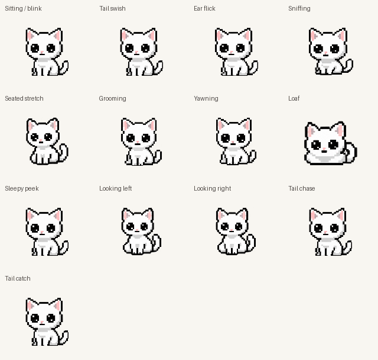
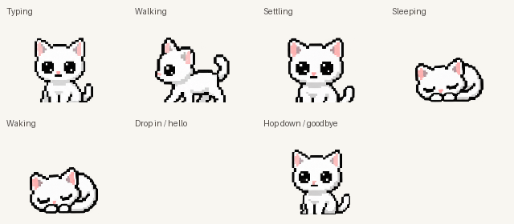

# Idle and activity animation catalog

The main catalog includes the default sitting loop and all eleven ambient moods.
Looking around has two directional variants, producing thirteen numbered entries.

1. Sitting / slow blink — default resting loop
2. Tail swish — one lazy eight-pose sweep, then rest
3. Ear flick
4. Sniffing — also responds to a nearby moving cursor
5. Seated stretch
6. Grooming
7. Yawning — also used when getting sleepy
8. Loaf
9. Sleepy peek — uses the sitting/blink drawings with different timing
10. Looking around, left-leading
11. Looking around, right-leading — same four drawings, different playback order
12. Chasing her own tail — eight drawings, a compact clockwise turn
13. Catching her tail — eight drawings, a seated attempt to pin the tip with one forepaw

All use the actual runtime SpriteAtlas and Clip timing. Ambient moods run at 10 FPS;
arrival/departure use continuous travel with approximately 30 FPS repainting. Ambient moods
are shown for their six-second slot, then return to the default sitting loop;
loaf has its eight-second slot. The catalog repeats every eight seconds and omits
the random wait between gestures so they can be compared side by side.

[Inspect the individual idle drawings](neko-idle-catalog-frames.png).

## Other non-petting sequences

14. Typing paw taps — typing, writing and coding reactions
15. Cursor walk — left-facing art; the app mirrors it to walk right
16. Falling asleep — eight transition drawings
17. Sleeping — two-drawing breathing loop
18. Waking up — eight transition drawings
19. Dropping in / hello — eight startup drawings
20. Hopping down / goodbye — eight quit drawings

These are displayed separately because their triggers differ from ambient idle
moods. Loops are shown continuously for inspection; transition clips finish and
hold their final drawing. The walking preview shows its leg cycle without moving
the window. The app still walks horizontally only.

[Inspect the activity and sleep drawings](neko-activity-catalog-frames.png).

The catalog covers every current non-petting clip. See [tail and lifecycle notes](tail-lifecycle-notes.md)
for the rebuilt art, exact generation prompts, visual QA, and startup/shutdown behavior.
