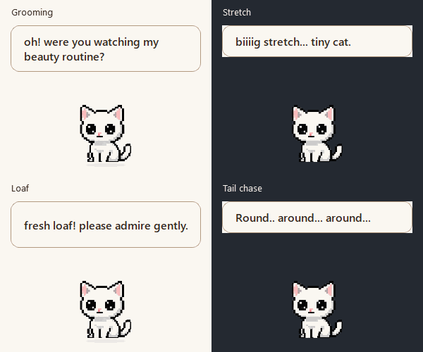

# Idle personality and readable thoughts

The cream bubble described below records the earlier revision. It has since been replaced by [background-free thoughts and startup fixes](startup-thought-validation.md).

[All idle poses](neko-idle-catalog-frames.png) · [Full idle catalog](neko-idle-catalog.gif) · [Native before/after thoughts](neko-thought-readability.png) · [Exact prompts](idle-personality-prompts.md)

## Implemented stories

| Action | Anticipation, action and recovery |
| --- | --- |
| Groom | Lift one forepaw, lick it, wipe behind the same ear, lower it, notice the viewer, tilt/blink, idle. |
| Stretch | Lean and plant forepaws, lower shoulders/raise hips, extend one existing hindleg, retract, paw shake, idle. |
| Loaf | Lower shoulders, tuck paws, hold a complete loaf, slow blink, unfold paws and sit. |
| Sniff | Nose reaches, lifts/twitches, curious tilt, ease back, blink, idle. |
| Ears | One ear reacts, little head turn, opposite ear/flick, return and blink. |
| Yawn | Drooping eyes, little mouth opens, cute full yawn, mouth closes, sleepy tilt/blink, idle. |
| Peek | Head lowers into a sleepy posture, one eye opens, ears perk, curious look/tilt, return. |
| Left/right looks | Head turns, curious tilt, front-facing blink, idle. Directional alternatives share the last eight source drawings. |
| Lazy swish | Keep the accepted body-registered sweep; add the canonical closed-eye blink before idle. |

The three new source sheets provide 64 used drawings: 24 from A, 16 from B and 24 from C. B's final eight swish candidates are excluded for proportion/registration drift; the accepted swish is retained and gains an existing blink. Replaced idle/activity/movement rows are excluded from runtime loading. The atlas now contains 195 entries, including the blink alias. Tail chase/catch timing, their increased selection weights, arrival, farewell and the twelve pet reactions are unchanged.

Every new story uses one measured seated-head calibration across its whole sequence, with a shared ground anchor. Deep stretch poses use padded source regions so paw tips survive row boundaries. First/last source candidates are replaced by canonical idle to avoid a resting-face change. Idle sequences finish within their existing six-second slots (eight for loaf) and then rest, including the shorter contextual loaf/sniff poses.

## Art review and corrections

Reviewed every used source drawing and ordered entry/action/recovery at desktop size and enlarged. Checked visible versus occluded legs, one connected head/torso, one attached tail, complete paws, head size, canvas borders and transitions.

- Groom draft switched the raised paw to the other side and left an extra arm. The accepted correction lowers the paw after wiping, then uses a grounded surprised look and head tilt; the malformed arm is absent.
- Swish draft had duplicate tails. A correction removed the duplicates, but its body proportions and registration still drifted. These candidates never enter the atlas; the verified sweep supplies the action.
- The first C draft had only twenty poses. Its correction supplies the required twenty-four in six populated rows. Saved PNG alpha was checked independently of the tool's displayed preview.
- Runtime review caught clipped front paws in deep stretch. Larger vertical sampling margins preserve the complete connected silhouette.
- The final source/runtime contact sheets show no extra limbs or detached tails in the used poses. Anatomy remains visually assessed; numerical checks cannot certify it.

Built-in ImageGen produced/edited the art with transparent alpha. Scripts only slice and render source artwork; no anatomy pixels were painted or patched programmatically.

## Matching thoughts and visibility

Every spontaneous idle now attempts a line from its own offline bank instead of a 25% gate covering only four actions. Banks include the user's “Look at meeee!” and “Round.. around... around...”. Shuffled bags still avoid repeats. Quiet, fullscreen, hidden/sleep/lifecycle restrictions, shared chatter pause and the existing-visible-bubble rule remain in force, so an attempt may intentionally stay silent.

Native rendering exposed the root visibility bug: the translucent top-level QLabel kept Qt's `WA_NoSystemBackground`, leaving its styled cream fill unpainted. Clearing that flag restores the fill. Text is now dark 16px semibold in a 270px-wide cream bubble, with a clearer border and 5.5–10s reading time. Position clamping and click-through/no-focus behavior remain unchanged.

The before/after image uses real native Qt labels over light/dark backdrops. The four-panel GIF uses native widget/atlas rendering and holds example captions for comparison; app reading time is checked separately by tests. Full catalogs use production clip timing and the existing 10/20/30 FPS sampling rules.

## Checks

- Focused animation/dialogue run: 24 passed.
- Full regression discovery: 130 run, 128 passed, two packaging checks skipped pending the build.
- Clean PyInstaller build passed; the executable includes all three new source sheets.
- Both packaging checks passed against that executable: archive contents, native startup, tray/window initialization and second-instance exit.
- Native Windows checks cover idle line dispatch/quiet behavior, painted bubble fill/font/reading time, all-state rendering, transparent source borders and previous pet-head calibration.
- The new entry/return, thought-bank, dispatch and font tests failed before implementation. The alpha-fill assertion separately failed on the original painting behavior and passed after the fix.
- An isolated in-memory mutation restoring `WA_NoSystemBackground=True` fails the visibility regression as expected. Production files were never mutated.
- Runtime idle/activity/tail catalogs regenerated; whitespace validation passed.

## Remaining limits

No physical mixed-DPI/multi-monitor check was available. Native font/readability checks use the current Windows display. The standalone Desktop copy is not overwritten automatically; use `dist/DesktopNeko.exe`.
