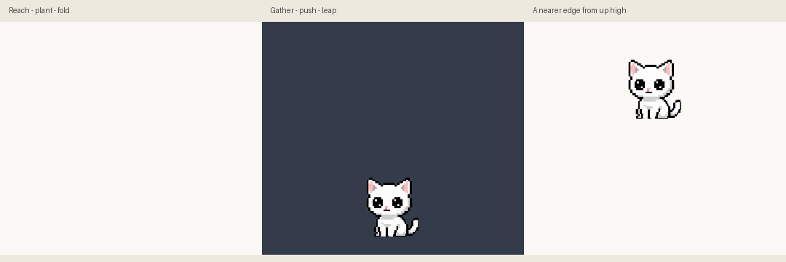

# One graceful diagonal leap · 2026-10-23

The user rejected the previous visitor acting and supplied a motion video plus four studies. Those originals remain in [the permanent reference library](../references/motion/README.md). The [revised plan](lifecycle-motion-v2-plan.md) was authorized, then refined explicitly to require one graceful diagonal entry and one diagonal exit.

[Face-hidden performance](lifecycle-v2-silhouette.gif) · [Light/dark full-canvas drawings](lifecycle-v2-frames.png) · [Exact prompts, complete crop rectangles and corrections](lifecycle-v2-prompts.json) · [Native Windows paints](lifecycle-v2-native.json) · [Invariant measurements](lifecycle-v2-invariants.json) · [Release identities](lifecycle-v2-release.json).

## Performance

Arrival is 1.98s with 19 selected entries. She enters already reaching down-right along a diagonal traced back to the first upper/left monitor boundary. She may therefore appear from the side instead of directly above her saved home. The first three drawings occupy 500ms of accelerating world travel. At first fore-contact the window reaches home and stays there: elbows yield, shoulders lower, the pelvis follows, hind feet gather underneath, and the supported body unfolds into a drawn turn/sit. An effort squeeze spans changing contact poses; a pleased tilt and smile finish before actual idle. There is one landing, with no second airborne bounce.

Departure is 2.20s with20 selected entries. The final user request adds a sad goodbye: ears lower, eyes soften/heavy-blink, head dips, then she turns through supported steps into a loaded crouch. The first700ms lets the emotion read across changing drawings. Expression/turn remains grounded until1000ms, load/push takes200ms, then flight lasts1000ms. Source6 is already airborne despite the original prompt requesting final toe contact. She stretches, gathers and reaches through one world arc: a single18px rise followed by diagonal descent. Low positions leave through the bottom; high positions choose a nearer side with proportional downward travel. Front-facing0/1/2/16 remain unmirrored in either direction; directional mirroring begins at the drawn turn17, preventing an early face/placement flip. The complete cat stays inside its fixed canvas; the monitor boundary owns disappearance.

The actual window follows the path, preserving the separate resting origin through saves, interruption and cleanup. Existing first-production-tick clocks, reduced motion, hide/fullscreen rules, repeated quit, sleeping/held immediate close, monitor-change cleanup and OS quit handling remain. No new settings, overlay, dependency, hook or data migration was added. Build-time atlas baking remains active.

## Drawing and assembly evidence

Six completed built-in ImageGen calls produced two twelve-pose key studies, two connected production sheets (20 arrival/16 departure slots), a four-slot corrective airborne bridge and an eight-slot sad-expression/grounded-turn sheet. An additional bridge request was interrupted before returning any image and contributes no artwork. [Arrival key source](lifecycle-v2-arrive-keys-source.png) and [departure key source](lifecycle-v2-depart-keys-source.png) preserve the first studies; head proportions were refined in production. Exact prompts/output identities and references' roles are recorded. Four selected sheets are saved in `assets/neko-lifecycle-{arrive,depart,bridge,sad}-v2.png`.

Complete high-alpha components locate original RGBA crop rectangles. Crops retain low-alpha pixels and are packed in four columns of 512px cells/baseline500, then sampled at128 using nearest neighbour. Calibration is fixed per source family, using neutral head62/height85 and ground132 to compensate the sampled transparent outline edge. Actual near-neutral visible crown/head/ground are checked against canonical idle. Arrival recovery12..19 uses its own neutral16; no pose is individually resized to fit. No anatomy or facial acting was painted procedurally.

Centering each changing landing outline made the supporting foretoe slide. Arrival1..11 is instead registered by the leading bottom foretoe; contact4..8 stays within one pixel while the body folds. This relies on the reviewed raised tails and is not a general limb detector. Departure3..5 has authored near-hind-toe translations through the loaded push.

Complete bounding crops retained neighbouring-row paw fragments in departure8/11/12/15. Those active drawings were rejected: the bridge replaces8/11/12; packed15 repeats clean14 as a final follow-through hold. Sad1/2 replace departure1/2, sad3..7 append as departure16..20. The cheerful original blink and redundant half-crouch3 are skipped, connecting sad20 into the retained deep load4/push5. Original selections/corrections remain in provenance. Actual idle replaces arrival19/departure0 at compatible endpoints. The atlas contains839 entries:786 retained,40 earlier v2 slots,eight sad slots and five appended aliases. All786 earlier frames/63 unrelated clips are unchanged.

## Checks

- `python -m unittest test_main test_animations test_startup_atlas -q`: **120 passed** after the sad transition. Covers expression/turn order/read time, single landing, one exit apex, diagonal travel, contact anchoring, near-idle size, monitor clipping, home persistence, interruptions and baked/source equality. One separately run passing painter regression covers the final mirroring correction: front sadness stays identical in both directions; the authored turn mirrors. Total121 source checks across these runs.
- Two earlier contact/high-route reproductions failed before their corrections and pass afterwards. The final steering adds direct single-leap and diagonal-path regressions. Existing travel/clip tests sample the new flight times and actual ink positions; they still check real movement and visible ink on one side of the monitor boundary.
- Separate invariants: all786 earlier frame hashes/63 other clips match; all53 new entries have one significant component at alpha≥128, ignoring1–2px specks. The permanent pet-fragment regression now also covers all53 lifecycle entries. Bounds/light-dark review pass. Components cannot certify attached anatomy or appeal.
- Real Windows event-loop probe uses the production timer and records `paintEvent` without a second driving timer. All19 entrance/20 exit entries paint; measured entrance2.050s, low/high exits2.265/2.278s, home restored and focus unchanged. Temporary settings/mocked activity hooks isolate preferences/input. A run concurrent with PyInstaller missed one short arrival entry; the subsequent run without the build passes. Time-based playback can skip intermediate art under load rather than extending the animation indefinitely.
- Both actual-controller previews decode to3000ms/54 coalesced GIF images. The silhouette version retains actual alpha with the face hidden. Documentation loops; real actions play once. Review-sheet height follows clip length to retain every dark-background row. The small scene monitor is a route example; travel distance varies with the desktop.

The final PyInstaller build and **four exact-executable checks pass**: resources/no credentials, supplied icon/normal-user manifest, all839 baked frames versus source, and native UI startup/second-instance rejection. All four new source assets have matching bundled hashes. One local UI-readiness run measured **2.209s**; this is not a controlled cold-cache benchmark. Baking keeps source preprocessing off the normal startup path.

The verified replaced executable was copied to ignored build storage before replacement and, after package checks passed, rotated into `dist/DesktopNeko-previous.exe`. Only it and the new `dist/DesktopNeko.exe` remain in dist. Exact hashes/byte counts/check identities are in the release record; intermediates stay under build. Historical validation reports remain intact.

## Limits

The artist review finds distinct reach, contact, gather, push and recovery silhouettes; the user's judgement of appeal remains open. No physical mixed-DPI/multiple-monitor trial, reboot/logon timing, broad gameplay rerun or long-session soak was added. Switching foreground to fullscreen during the brief exit was not separately exercised. Native probes use the available monitor; boundary regression simulates a neighbour. High-perch travel is bounded by clip duration and can still appear quicker on a large desktop. One-file startup also varies with disk cache and Windows scanning.
