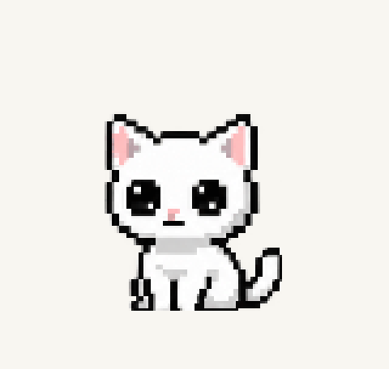

# Pet scale and palm cursor

The cursor behavior below remains current. The pet source calibration described here is historical; the [expressive petting revision](petting-revision-validation.md) uses full sequences, a fixed seated-reference calibration, aligned drawn recovery and extra transparent drawing room.

## Size matching

The previous loader fit every source silhouette to an 82-pixel height. That made
the different head/body proportions in the pet sheets visible as a shrinking head
on click, even though the output canvases matched. The newer pet sheets also used
a tallest-frame limit, so a raised tail could shrink an entire reaction.

The twelve pet rows now have measured source-head landmarks in `PET_HEADS`.
Width and height are calibrated to the existing idle head, approximately 62x50
pixels; its starting top is kept at 16 pixels. Those two calibration factors stay
constant through each reaction, allowing actual crouching, leaning, ear movement
and turning without refitting each pose. This corrects the differing source
proportions rather than stretching every whole kitten into the same bounding box.
Remeasure these landmarks if the corresponding versioned PNGs are replaced.

All runtime frames now have a 112x112 canvas, matching the existing desktop window.
The idle art remains at its existing visible size and screen position. The extra
transparent space below allows the calibrated pet bodies to fit without cutting
off their paws. The common drawing origin, saved window position and cursor-walk
speed remain unchanged. No source pixels or anatomy were edited or regenerated.

## Palm interaction

Qt's widget-local [open/closed hand cursors](https://doc.qt.io/qt-6/qt.html#CursorShape-enum)
provide the pan-style hover and held-hand states. A deliberate pet release uses
nine small vector-drawn palm frames, 70ms each, with a fixed 16x16 hotspot.
Only the displayed cursor image shifts by up to two pixels; the pointer position
is never changed and no application-wide cursor override is installed.

The stroke is cancelled on leaving, hiding, entering fullscreen, lifecycle transitions,
quitting or disabling motion. Drag releases do not pet or play the stroke. With
reduced motion, the normal open/closed hand interaction remains available.
There are no new dependencies or raster cursor assets.

Custom GIF replacements continue to use their own artwork and original rendering
path; the scale calibration applies to the bundled atlas drawings.

## Verification — 2026-10-21

- All 48 pet poses were inspected in a runtime contact sheet beside idle; the
  catalog shows idle before and after each reaction. No source art was changed.
- Tests reproduce the original head-width mismatch, then verify all twelve starting
  heads against idle, their common starting top, and clear pixels along every
  canvas edge to guard against clipped ears, tails or paws.
- Full suite: 115 tests, 113 passed and two opt-in packaging tests skipped.
- Five focused checks passed with native Windows Qt: palm state/strokes, drag
  separation, reduced motion/hiding, every pose rendering, and lifecycle repaint.
- Clean executable build and archive check passed; `cursors` is bundled. A launch
  while the existing Neko owns the lock exits cleanly. A fresh packaged startup
  remains deferred to avoid closing the user's running desktop copy.
- The pet catalog and palm-preview GIFs decode and retain their eight-second and
  2.4-second durations. Every palm frame uses the same hotspot; tests verify that
  the actual pointer does not move.
