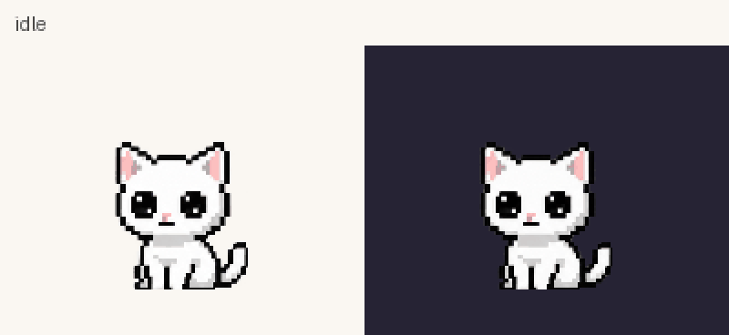

# Pickup and held expressions — 2026-10-22



[Approved design](pickup-animation-plan.md) · [Exact prompts, rejections and assembly](pickup-prompts.json) · [Every source slot](neko-pickup-frames.png) · [Six posture entries](neko-pickup-entry-frames.png) · [Seven complete release stories](neko-pickup-release-frames.png) · [Half-speed preview](neko-pickup-preview-slow.gif) · [Native light/dark captures](neko-pickup-native.png) · [Native measurements](pickup-native.json) · [Authoring method](../framemaster.md)

## Interaction delivered

A short left click still pets. Crossing Qt's normal drag-distance threshold begins pickup immediately; a stationary left press becomes pickup after 250ms. Tiny motion below the distance threshold preserves the short-click behavior. Once pickup starts, releasing never also pets, even if the kitten was not moved. The existing closed-hand cursor retains its hotspot and the actual pointer is never warped.

Awake holding progresses by elapsed active hold time, rather than mouse-move events:

| Elapsed hold | Acting and timing |
| --- | --- |
| First 400ms | Eight lift drawings: anticipate, release forepaws, unfold hindquarters and settle into hanging. The actual visible starting frame is retained. |
| 0–3s | Bright eyes, perked ears and a brief playful eye squeeze in the excited loop. |
| 3–10s | Four 100ms expression-bridge drawings lead into relaxed half-lids and restrained paw/tail movement. |
| 10–20s | Another four-drawing bridge leads to level heavy lids, a tiny flat mouth and a subtle sideways ear adjustment. |
| 20s onward | One 650ms drawn yawn, then an eight-pose closed-eye breathing loop indefinitely. The yawn does not repeat with that loop. |

The held body loops share a 2.4s period and a fixed head/shoulder reference. Excited/calm/unimpressed each use twelve source phases; sleepy uses eight closed-eye phases. Normal motion uses the existing precise 50ms Qt timer. A held sleepy expression does not increment the real nap count.

Release responds from the visible pose during entry, loops, facial transitions or the yawn. It preserves that first frame, uses drawn jaw/lid connections where needed, and lowers into the authored contact/compression/sitting recovery. The common landing clip is 700ms; the complete normal release is approximately 750–1100ms depending on the expression/closing bridge. Landing uses the user's selected location, not a fall to the taskbar or a replay of startup arrival.

Early release retraces the part of the lift already performed and completes the starting gesture's drawn recovery. Its length depends on the starting posture. Re-grabbing retraces release from the visible position, then finishes any unvisited lift drawings. The expression clock pauses during release and retracing, so returning to the held pose resumes the same face/bridge/yawn phase. Mouse movement during uninterrupted holding does not restart its clock.

## Posture and nap continuity

Dedicated eight-drawing entry families connect low stretches, side/curl poses and rolled poses to the common held body. They use the final upright held drawing as their scale reference. The ordinary upright lift handles seated and compatible raised poses. Selection considers the current state and silhouette, preserving the actual starting frame and fading its placement offset over the entry rather than inserting idle first. Awake side entries include a drawn eye reopen.

A real sleeping/falling-asleep kitten uses closed-eye side entry and returns through that same physical bridge in reverse to the appropriate curled sleep transition. Nap identity/counts and timing remain intact. A timed wake that becomes due while carried waits for supported placement. Carrying during an existing wake finishes upright instead of replaying a partial wake after landing.

Hide, fullscreen hiding, lost mouse capture, monitor changes, menus and quit clear pickup ownership safely. A missed outside release is also checked by the desktop tick. Fullscreen detection still runs during a hold. Existing arrival/departure remain input-locked, and quit hands off from a supported state into its existing departure. Reduced motion uses a stable held drawing and immediate placement; changing it during set-down finishes that set-down immediately.

Pickup discards pending pet/window reactions and invalidates stale AI replies. It suppresses competing idle/typing/nap gestures and thoughts while it owns the visual state. After an awake set-down, future idle/nap deadlines are scheduled from completion. No settings, new thought panels, sounds, physics engine or runtime dependency were added.

## Size, position and source construction

The fixed transparent canvas is **192 × 144**, adding 32 empty pixels above the previous 192 × 112 area. The seated head remains approximately 62px wide and the seated body approximately 82px tall; the dangling body is about 100px. Canonical crown/ground references shift to y=48/y=130; the held crown is y=16. The kitten is not shrunk to fit the hanging pose.

Saved positions retain the original visible-origin convention through `QPoint(40,32)` on load/save. Temporary lift and descent happen inside the canvas; they never enter the saved window origin. The tray crops the original central 112 × 112 area at `(40,32)`, and thought/follow anchors preserve the old visible coordinates. Transparent padding remains click-through.

Nine `assets/neko-carry-*-v1.png` sheets supply **100 source slots** plus one appended actual-idle entry. The atlas now has **528 entries**. All 427 pre-pickup drawings remain pixel-for-pixel identical after removing the new top padding, and all 32 earlier clip definitions are unchanged, including the accepted tail games.

Built-in ImageGen authored the drawings. Extraction/packing selects complete existing silhouettes without painting anatomy or expressions. Cells use a minimum 384px extent, expanding shared cell dimensions for larger source drawings. Import samples each cell to 128px wide before silhouette detection, as the existing pet importer does, then retains one measured calibration per bank. Head measurement uses the upper 40% to exclude high tails. A damaged/missing carry sheet rejects the carry set as a unit, preserving ordinary drag/fallback behavior.

## Rejected drafts and corrected defects

- The first sleepy sheet shortened the body and left detached imported components of 12 and 5 pixels. It was rejected. A face-only edit against the accepted calm body supplies the final yawn/sleep loop; all imported drawings pass the fragment and scale checks.
- The first rolled entry and a background-extraction edit retained a gray halo. Both were rejected; the final fresh redraw has clear transparent gaps and passed light/dark review.
- Early re-grab initially skipped unvisited lift drawings, producing a reproduced 22px crown jump at the handoff. Retaining the remaining lift fixes the transition; a regression verifies the final handoff within two pixels.
- Resuming by wall-clock time could skip a facial bridge while release/re-grab was in progress. The visual hold clock now pauses during that return path, with a boundary regression proving the excited-to-calm bridge still plays.
- The first baseline hash probe used a temporary QImage before copying its exposed buffer. It was replaced with a retained-image comparison against commit `199392b`; all 427 pixel comparisons and 32 earlier clip comparisons passed. Production rendering was not affected.
- The all-states render regression constructs carry states without a live gesture payload. This exposed an unsafe renderer assumption. Such states now render a safe idle fallback and can be cancelled; the original all-states check and a direct regression pass.
- The full suite detected a one-pixel walking-anchor shift from replacing Qt's rectangle center with integer half-width arithmetic. Using the original footprint's adjusted rectangle center restores the exact earlier horizontal stop point; the walking regressions pass.

## Verification

- Reviewed all 100 imported source slots, their adjacent entry/loop/release connections and the native light/dark captures for physical volume, attached neck/torso/tail, four anatomical legs with natural occlusion, paw support, expressions and alpha cleanliness. No extra limbs or detached anatomical parts were observed in the accepted artwork. This is a visual assessment, not an automated anatomy guarantee.
- Render checks cover complete banks, transparent bounds, one significant connected silhouette, head scale/anchor/body volume, actual-idle endpoints and intact fallback when a bank is damaged. Behavioral/desktop checks cover click/hold boundaries, all moods, re-grab, real naps, pending reactions, saving and cancellation.
- The 27-second catalog is generated from the actual controller/atlas at 20 FPS. Its decoded duration and coverage of every used held/bridge/yawn pose are asserted. Release sheets show early release, excited, calm, unimpressed, mid-yawn, sleepy and real-nap placement using actual controller paths.
- Native Windows playback observed all expected entries through the real four-stage hold: eight lift entries, twelve phases in each awake loop, eight sleepy phases, both four-pose bridges, the four-pose yawn and all thirteen final release entries.
- Fourteen additional native release cases passed, from 25ms into lift through expression boundaries and mid-yawn to a simulated long-hold phase. Every selected release entry was observed. Native stretch/flop/roll/nap entry and release paths were also observed completely, with counts and resting position unchanged.
- On the available DPR 1.0 display, median paint interval was **49.973ms**. First release paint measured **0.624ms median / 1.006ms maximum** in the final run. These are observed host results, not latency guarantees on other systems.
- Native hit-testing passed for the new blank top margin, the side margin and the visible kitten; saved visible origin round-tripped correctly.
- Four additional native re-grab cases passed: early lift, excited/calm boundary, mid-yawn and a real-nap pose. Every return-path drawing was observed; final crown handoffs remained within two pixels. All four primary-screen corner clamps fit the full 192 × 144 footprint.
- Native Qt mouse press/move/release events on the visible Windows widget moved it by exactly 80 × 40px, preserved the drag offset and saved placement, returned to idle, left the real pointer unchanged and added no pet count.
- The source release matrix covers 86 samples: every lift/held/face-bridge/yawn phase, just before/at/after boundaries and a long-hold phase. Thirty-six sampled pet starting postures retain their visible first frame and clear vertical bounds. Reduced-motion changes during hold and release, and full-footprint negative-coordinate popup placement, also pass.
- Final full discovery: **171 run, 169 passed, two opt-in packaging checks skipped**, in 403.161s. Both packaged checks then passed on the fresh executable. They verify required modules/resources, all nine carry and twelve pet PNG hashes, clean native startup/tray/topmost behavior, second-instance rejection and exclusion of credentials/unrelated ICU. Only test-owned executable processes were stopped.
- Normal and half-speed catalogs decode to **27s and 54s**. The preview tool asserts every used held/bridge/yawn entry and exports all 100 source slots, six current-pose entry stories and seven complete release stories.

## Delivered build

`dist/pickup-qol/DesktopNeko.exe` — 100,251,184 bytes. Source/art commit: `e227e0b`. SHA-256:

```text
78da7654dd1450d3c0b8755c7fd731a60125e6ffe9f9c04d8f3fb3346e42b918
```

Earlier executables remain separate. Quit an older Neko before opening this build; the shared single-instance lock intentionally prevents duplicate companions. [Machine-readable measurements](pickup-native.json) contain the full source commit, build hash and individual native cases.

## Limits

Physical mixed-DPI/multiple-monitor transfer and long-session resource behavior have not been exercised. Negative-coordinate popup geometry can be tested synthetically, but it does not substitute for those physical display checks. Anatomy and subtle acting still require visual review alongside the numerical tests.
