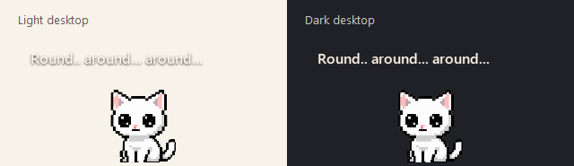

# Startup drop-in and transparent thoughts

The user reported that the drop-in was missing when launching Neko and requested thoughts without backgrounds. This correction preserves the accepted sprite artwork, pet scale, palm cursor and idle sequences.

## Changes and evidence

The arrival clock previously started before Qt's event loop could animate the window. A regression simulating a 2.5-second delay before the first animation tick reproduced an immediate jump to the landing position. The clock and completion timer now start on that first tick, leaving the full fall and landing sequence available.

A second reproducible path skipped arrival whenever the foreground window was detected as fullscreen, even with fullscreen hiding disabled. A visible startup now plays the drop-in silently. If hiding is enabled, the kitten stays hidden. Switching that preference or losing a monitor during arrival safely finishes the transition and restores the landing position.

Neither path was confirmed as the exact trigger on the user's machine: an ordinary native source launch worked during investigation. Both failing paths are covered by regression tests.

Thoughts now use transparent margins, no panel and no border. Cream 16px semibold lettering has a small dark shadow, with the existing word wrapping, reading time, quiet controls and click-through behavior. Native Windows renders were inspected over both light and dark surfaces. Tests verify transparent margins, visible light glyphs and dark shadow pixels, and repainting when the words change.

A native first-show probe deliberately blocked event processing for 850 ms, then observed the kitten moving from y=-112 through intermediate positions to y=500. It completed the landing before returning to idle and greeting. Temporary settings were used; the probe did not change the user's preferences.

## Completed checks

- Full regression discovery: 136 tests run, 134 passed, two opt-in packaging checks skipped.
- The bundle-content check was then enabled separately and passed against the rebuilt executable.
- Focused native Windows checks passed for delayed startup, monitor-top clipping, fullscreen visibility, monitor-change interruption, transparent glyph rendering and changing captions.
- An isolated in-memory mutation inverting the arrival-start condition failed the delayed-start regression, as intended. Production files were never mutated.
- PyInstaller rebuild passed. Extracted bytecode for startup, animation, clamping and thought initialization matches the verified source.
- Whitespace validation passed. No art assets, dependencies or settings were added.

## Delivery and limits

The corrected build is `dist/updated/DesktopNeko.exe`. The existing Neko process keeps the previous executable locked, so it was preserved. Quit it from the tray menu before launching the updated build.

Physical mixed-DPI/multi-monitor testing was not available. A fresh packaged launch remains unverified while the user's Neko is running; native source startup and bundle inspection passed.
