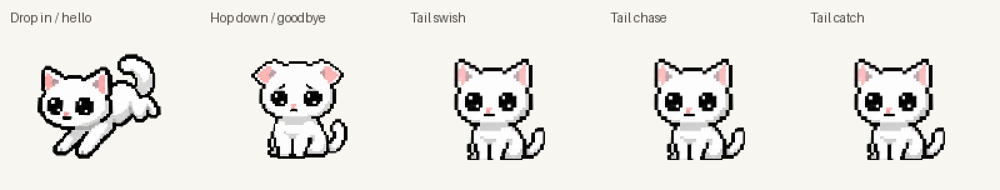

# Playful tail games, arrival and goodbye

[Monitor-scene arrival and farewell](neko-lifecycle-scene.gif) · [Native-size playback](neko-tail-life-native.gif) · [All used source poses](neko-tail-life-source-frames.png)

The latest revision follows the user's crouched tail-chasing reference. One eight-view stepping cycle repeats twice for the chase and three times before the catch/pounce. The whole kitten turns while her nose follows a single attached tail. Preparation, a low pounce, two-paw catch, escape and sitting recovery are separate drawings. Chase lasts 4.11 seconds; catch lasts 5.42 seconds, both inside the six-second idle slot. The lazy swish and twelve pet reactions remain as previously calibrated.

Arrival lasts 1.9 seconds. Her actual 112px desktop window moves from just above the target monitor to the saved landing position over 700ms, with accelerating travel. Complete airborne/forepaw-contact poses lead into compression, a cheerful rebound and the canonical idle drawing. Ink is clipped to the target monitor's top edge, including when another monitor sits above it. The monitor-scene preview uses the production trajectory and atlas; the pose catalog alone does not show desktop window travel.

Departure lasts 2.15 seconds. A sad look with lowered ears appears immediately for 650ms; a second downcast pose holds 350ms. The retained crouch follows for 200ms, then the previously accepted hop drawings and upward/downward arc. There is no new dialogue. Only the first two farewell candidates are imported.

The atlas has 150 entries. neko-tailplay-v3.png, neko-arrival-v1.png and neko-farewell-v1.png provide the new art. neko-lifecycle-v2.png remains for its accepted departure poses; its old arrival rows are not loaded. Tailplay v2 is removed from the bundle. Shared idle endpoints prevent a face change at rest.

Generated poses slightly cross nominal row boundaries. Arrival and tail cells use padded sampling regions, connected-silhouette bounds and constant width-based source sampling, so paws are retained without changing scale between rows. Whole sequences share a scale and ground anchor; frames are never individually fitted to their bounding boxes. No anatomy pixels were painted or patched programmatically.

Every used new pose was inspected at enlarged and desktop size for one connected body/head, four anatomical limbs total (with occlusion), one attached tail, complete paws and consistent proportions. Two turn views and oversized arrival tails were corrected through ImageGen. Runtime review caught and corrected row-boundary paw clipping. Numerical tests cover silhouettes, timing, turns and state transitions; they cannot certify anatomy.

Position saves always use the landing target during flight. Hiding, motion-off, fullscreen, quitting and monitor removal restore that target before proceeding. Greeting happens after landing, unless interrupted. Petting and window reactions cannot interrupt lifecycle states; repeat quit does not restart farewell. Reduced motion and hidden/fullscreen quit remain immediate. Palm feedback and idle/pet head calibration remain unchanged.

See [exact prompts](playful-motion-prompts.md), [verification](playful-motion-validation.md) and the earlier [rebuild record](animation-rebuild-validation.md).

Rebuild previews with .venv\Scripts\python.exe tools\preview_animations.py (optional Pillow). These use production atlas/timing, 30 samples/second for lifecycle and the app's 10 FPS for ordinary actions. GIF loops are documentation replay; startup/departure run once.
