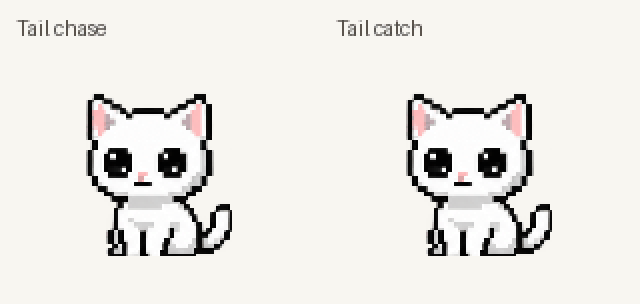

# Longer tail chase, cute transitions and frequent special idles — 2026-10-21

## Result

- Chase: five turns at the accepted 550ms per turn; 4.69s including entry/recovery.
- Catch: two turns at the same speed, followed by its existing pounce/catch/release; 3.68s including entry/recovery.
- Both fit the existing six-second idle slot, then rest. The chase lasts 1.01s longer than catch.
- Each tail game gets three times an ordinary idle's selection weight. The last idle is excluded before weighting. Other idles and configured time between gestures remain unchanged.
- Eight new transition drawings are appended to the tail bank as indices 16–23; 158 total atlas entries. The accepted running sheet and all other character art are unchanged.

## Art and handoff inspection

Built-in ImageGen produced `assets/neko-tailsettle-v1.png` from the accepted tail sheet and idle identity reference. [Exact prompt](tail-transitions-prompts.md).

Reviewed all eight source poses plus entry and recovery sequences in playback order at runtime scale and enlarged. Entry: seated idle, eager head tilt, crouch, run-ready, then accepted run. Chase recovery: final run, lowered hips, half-sit, contented tilted blink, canonical idle. Catch recovery: pounce/catch/release, crouch, half-sit, blink, idle. First and last seated candidates are replaced by the actual idle frame to keep the resting face consistent.

No additional limbs or disconnected tails were observed. Forepaws stay planted through the half-sit; rear legs are tucked or occluded where appropriate. All used source silhouettes fit the 112px transparent canvas with clear borders. Separate calibration of the new sheet keeps the established running drawings unchanged. Source padding retains extremities across nominal cell boundaries. Scripts render/slice art; no anatomy pixels were painted or patched programmatically. Anatomical correctness remains a visual assessment.

## Checks

- Red/green: new duration/transition test and both selection regressions failed before implementation, then passed.
- Focused animation/behavior run: 45 passed.
- Full discovery: 125 run, 123 passed, two packaging tests skipped pending rebuild.
- Clean PyInstaller build passed; `dist/DesktopNeko.exe` contains the transition sheet.
- Packaged executable checks: both passed, including archive contents, native startup, tray/window initialization and second-instance exit.
- Four focused native Windows checks passed: tail versus walking cadence, all-state rendering, source border clipping and previous pet head calibration.
- A 3,000-selection seeded simulation passes the 30–45% combined tail-game share range, no consecutive repeated idle, and coverage of every ordinary idle.
- Isolated in-memory mutation removing the extra tail weight fails the new exact-weight regression, as expected. Production files were untouched.
- Runtime catalogs, source contact sheets and exact-50ms tail preview regenerated. `git diff --check` passed.

## Scope limits

No new physical multi-monitor hardware check. The old standalone Desktop executable is not overwritten; use the rebuilt file in `dist`. [Other-idle ideas](idle-personality-ideas.md) are proposals rather than implemented animation changes.
