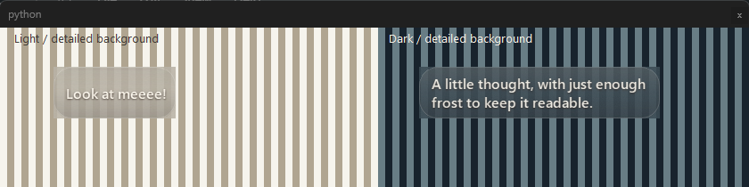

# Compact frosted thoughts — 2026-10-22

The user approved a small blur behind Neko's lines to improve readability. The earlier background-free requirement is superseded for the thought label, not for kitten sprite art. The [dedicated Catch the Cursor design](catch-the-cursor-plan.md) is planning only; no game logic, artwork, queue or automatic-game preference is implemented here.

## Implemented

`ThoughtLabel` keeps cream 16px semibold text sharp, paints a rounded translucent tint and requests native blur behind the window. The glass refinement replaces the original alpha-110 dark fill with an alpha-10–32 highlight/shade gradient (about 4–13% opacity) and a faint alpha-64 rim. The latest adjustment uses a 20px radius consistently for the native region, paint and styling, plus 88% whole-window opacity to blend more clear desktop detail through the effect. This changes effective frosting rather than Windows' fixed native blur radius; lettering/shadow also share that opacity but remain sharp. Short thoughts use their measured width rather than a permanent 270px panel; longer thoughts wrap within that maximum. Existing dark shadow, 5.5–10s reading time, visibility/quiet rules, plain-text handling and screen clamping remain. Native input-transparent/no-focus flags preserve desktop interaction.

The runtime does not capture the screen or transmit background pixels. Blur is a compositor effect; the native preview tool captures only its own deliberately drawn test window. No new runtime package or sprite changes were introduced.

## Chosen method and rejected approach

[Microsoft's documented transient-window backdrop](https://learn.microsoft.com/en-us/windows/win32/api/dwmapi/ne-dwmapi-dwm_systembackdrop_type) plus extended frame returned success on this machine but produced a uniform opaque surface while the tooltip stayed unfocused. A two-color background trial exposed that difference; API success alone was insufficient visual evidence.

The accepted path dynamically calls [SetWindowCompositionAttribute](https://learn.microsoft.com/en-us/windows/win32/dwm/setwindowcompositionattribute) with the private accent-policy blur value. Microsoft does not recommend this API in preference to documented backdrop attributes; the accent policy itself is not a public compatibility contract. Its use is isolated, typed for pointer-sized handles/data and guarded against unavailable/failed calls. The rounded tinted background remains readable if blur is unavailable. A `shortcut:` comment records that limit; migrate if a dependable documented backdrop becomes suitable for these unfocused transparent labels.

Do not replace this with a blur effect on the label's text: that would soften the lettering instead of the desktop. No periodic desktop screenshots, input hook or pointer manipulation are needed.

## Verification

- Five focused source checks passed: compact/wrapped sizing, unavailable/failed-native-call fallback, translucent rounded rendering/read time/input flags, changing words, and quiet/visible-thought behavior. The rendered-tint regression first failed because QLabel styling did not paint the translucent surface; explicit rounded background painting corrected it and the focused cases were rerun.
- `tools/preview_thoughts.py` ran against actual Windows Qt at DPR 1.0. Both labels reported native blur, native hit testing went through to the test-owned underlying window, and the foreground window remained unchanged.
- Background stripe contrast is now 13 under the gentler glass, compared with 4 before this adjustment and 70 outside the effect: more original detail remains visible. The preview includes the same glyph shadow used by the real companion. Native review also checked the rounder corner cutouts and that broad background colors remain visible, unlike the rejected opaque acrylic treatment. The [measurements](thoughts-native.json) and image above record the accepted glass style; focused rendering checks verify the corner cutouts and 88% opacity too.
- Both packaging checks passed on the exact fresh executable: bundled resources and the new `thoughts` module, native startup/tray/topmost and single-instance rejection. Only test-owned processes were stopped. The user quit their prior running build before replacement.
- `dist` contains exactly the current and immediately preceding executables; no release subdirectories were created.

## Delivered files

- Current: `dist/DesktopNeko.exe`, 100,255,334 bytes; SHA-256 `716f99473a6cb20b4734471bce96b904478b20c0f2fb870049a0d56f42c6dfbe`.
- Previous: `dist/DesktopNeko-previous.exe`, 100,253,984 bytes; SHA-256 `82fdf5fd139830c34f8a2b669b1567d180fd21420c82fd16908b4c84a9dd3caa`.

Full discovery, physical mixed-DPI hardware, Windows 10 and long-session resource testing were not repeated. The OS can disable or alter blur; the tint is the deliberate fallback, not a guarantee of native blur on every machine.
