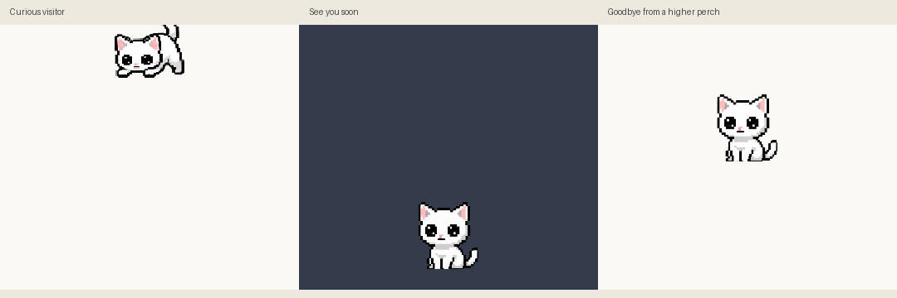

# A little visitor — delivered 2026-10-23

The user approved the [entrance/goodbye research](arrival-goodbye-research.md) with “DO me proud.” This release replaces both lifecycle performances while retaining the earlier artwork, pet/game/carry behavior and build-time atlas optimization.

[Full-canvas light/dark pose review](visitor-frames.png) · [Native Windows paint records](visitor-native.json) · [Exact prompts, references, crop regions and asset hashes](visitor-prompts.json) · [Executable/source identities](visitor-release.json).

## Final performance

Entrance is 2.15s, with 20 selected poses: a supported curious lean and head tilt at the monitor top, a gathered release, changing descent, forepaw contact and yielding compression, a complete supported sit, pleased tilt/smile and reopening into actual idle. The first 400ms read as a curious look into the scene; release preparation follows, world descent starts at 500ms and reaches the saved landing position at 1050ms. The monitor masks the initial upper silhouette. This is the research's head-leading fallback, not a claimed hanging paw grip.

Goodbye is 1.8s, with 16 selected poses: canonical sit, affectionate tilt, half-lids/closed/reopening slow blink, a look toward the exit, a gathered crouch and a confident hop down. The window follows an 18px initial rise and accelerating fall to its selected monitor's bottom; the attached upward tail naturally crosses last. Lateral travel is at most 40px and mirrors inward on the right half. The full drawing stays intact in its canvas; disappearance occurs at the monitor boundary, including clipping away ink that could otherwise appear on a neighbour below. A higher starting position makes a faster descent within the same close budget; enjoyment of that pacing remains a human judgement.

Both clocks start on the first production animation tick. First show selects the arrival before exposing the window. A delayed load cannot consume the performance. Entrance completion restores home and resets ordinary deadlines before greeting; no new dialogue was added. Hide/Show stays immediate. Ordinary care/game states cannot replace a lifecycle performance. Only a compatible idle or interrupted arrival starts the seated goodbye; sleeping, held or other incompatible poses quit immediately rather than snapping awake/upright. Existing hidden/fullscreen/reduced-motion immediate quit behavior remains. Explicit fullscreen-hiding changes, motion-off and monitor changes finish/cancel safely; normal OS/application quit is not held waiting for an animation.

Departure now retains a separate resting origin. Saving during its travel, final cleanup and monitor-change closure restore/use that origin. Repeated quit does not restart the performance. No new preference, overlay, input hook, runtime dependency or user-data migration was added.

## Artwork and correction

Three built-in ImageGen calls produced genuine-alpha source sheets. Selected workspace assets:

- `assets/neko-visitor-arrive-v1.png`: 20 packed source slots.
- `assets/neko-visitor-depart-v1.png`: 16 packed source slots.
- `assets/neko-visitor-recover-v1.png`: eight separately calibrated corrective slots.

Complete high-alpha silhouettes were used only to locate full original-RGBA crop rectangles, then packed into four-column 384px cells at baseline372. Alpha below the threshold inside those rectangles is retained. No limbs, expressions or replacement alpha were painted procedurally. Import uses the existing nearest-neighbour sampling and one neutral head/height calibration per source batch, with the 192×144 canvas and ground130.

The first full entrance sheet was a useful pose prototype but its seated recovery shrank to 67px compared with canonical 83px bounds. It was rejected for the active recovery. A separate drawn eight-slot recovery fixes this: arrive14..19 select recover1..6 and arrive20 appends actual idle after the physical recovery. Near-neutral size/crown/baseline tests pass. The original source sheet is retained in provenance rather than silently altering it. The new atlas has 786 entries: 741 retained entries plus 44 visitor source slots and an appended arrival idle. Recovery aliases replace six arrival entries rather than increasing that total again.

All 741 prior imported frames compare byte-identically, and all 63 unrelated clip definitions are unchanged. Existing game/pet/carry previews and provenance remain historical evidence. [Current preview helper](../tools/preview_lifecycle.py) uses the actual `NekoWidget.animate` and `paintEvent`; the existing preview helper delegates its lifecycle scene to it. The new light/dark sheet preserves the full 144px canvas so the raised tail is not accidentally cropped by a legacy 112px catalog.

## Verification

- Three control reproductions failed before the corresponding runtime fix: departure did not travel, sleeping quit played an awake goodbye, and delayed first tick could consume departure time. They pass after correction.
- `python -m unittest test_main test_animations test_startup_atlas -q`: **115 tests passed**. Coverage includes corrected near-neutral size, monitor-edge ink clipping, monitor-change cleanup, origin persistence, first-tick timing, repeated quit, reduced motion, hide/fullscreen preferences, packed/source equality and existing desktop/animation regressions.
- Separate invariant check: all 741 prior frames/63 other clips unchanged; all 45 imported visitor entries have exactly one significant connected component at alpha≥128, ignoring components of at most two pixels. Bounds checks and light/dark inspection pass. Component counts cannot certify attached anatomy; the selected drawings were also visually reviewed.
- A real Windows event-loop probe observes actual `paintEvent` calls under the production animation timer, without a second timer driving `animate()`. All 20 arrival and all 16 goodbye pose indices are painted. Low/high exits finish in approximately 1.87/1.89s; entrance in 2.20s including first-tick/event-loop overhead. Foreground stays unchanged and home is restored in all three scenes. Temporary settings and disabled test activity hooks isolate user preferences/input. Exact records are linked above.
- The 3s actual-controller GIF decodes to 3000ms; Pillow coalesces identical holds into 52 encoded images. It is a repeated documentation preview; real entrance and exit play once.
- PyInstaller build passed. **Four exact-executable tests passed**, checking source resources/no credentials, supplied icon/normal-user manifest, every packed frame against source import and native startup/second-instance rejection. All three new source assets are verified by their bundled hashes.
- Real packaged UI readiness measured **2.539s** in one local run. The earlier optimized release measured 2.140s on its own run; these are not controlled cold-cache comparisons. Build-time baking remains active, and the former five-second source preprocessing is not on the normal startup path.

After the new executable passed its package checks, the verified replaced build was preserved as `dist/DesktopNeko-previous.exe`; the new build is `dist/DesktopNeko.exe`. Only these two outputs remain in `dist`; intermediates live under ignored `build/visitor`. The release record includes exact bytes and hashes.

## Remaining limits

No physical mixed-DPI/multiple-monitor trial, reboot/logon timing, broad game/behavior suite or long-session soak was added. The boundary regression simulates a lower neighbour; native playback uses the available monitor, with low/high positions and its actual geometry. Quiet/fullscreen visibility and first-tick correctness are covered, but switching foreground into fullscreen during the brief departure was not separately exercised. Artwork appeal and very high-perch pacing still benefit from the user's play-testing. Windows security scanning and storage can change one-file startup time. Historical reports were preserved.
